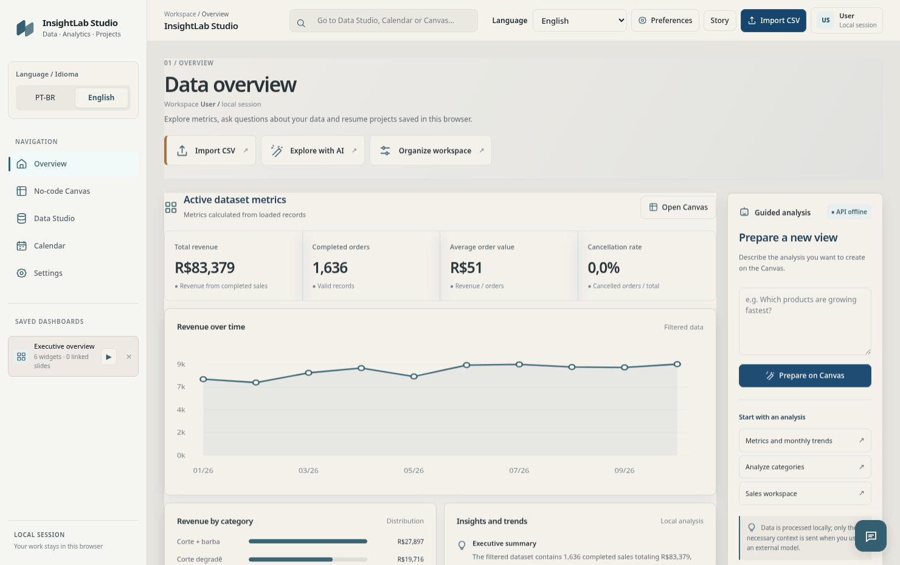
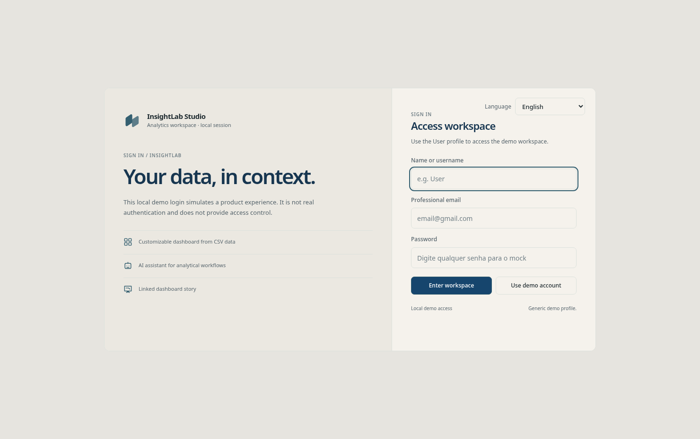
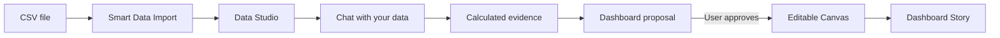
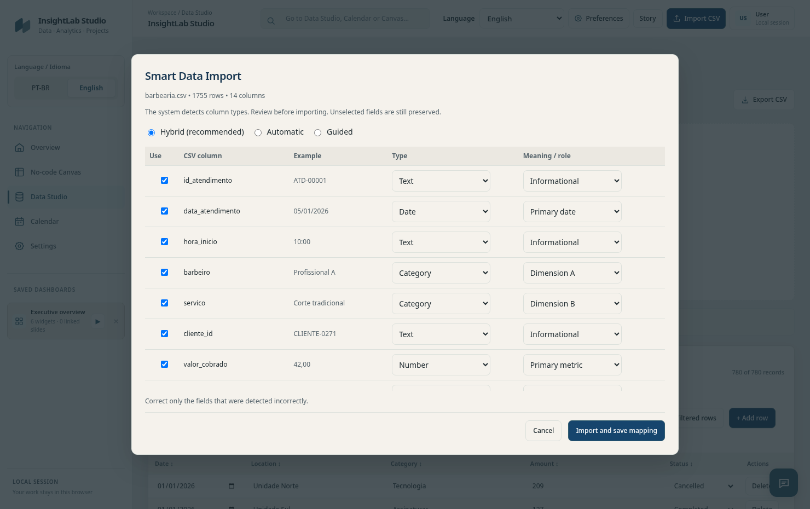
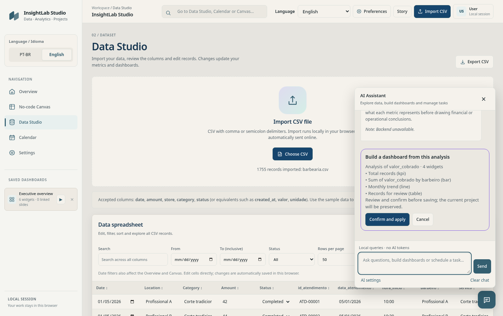
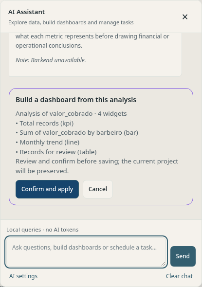
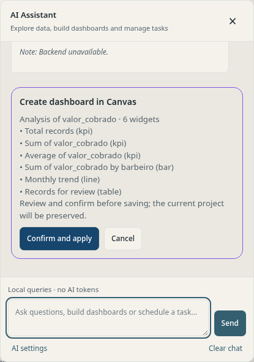
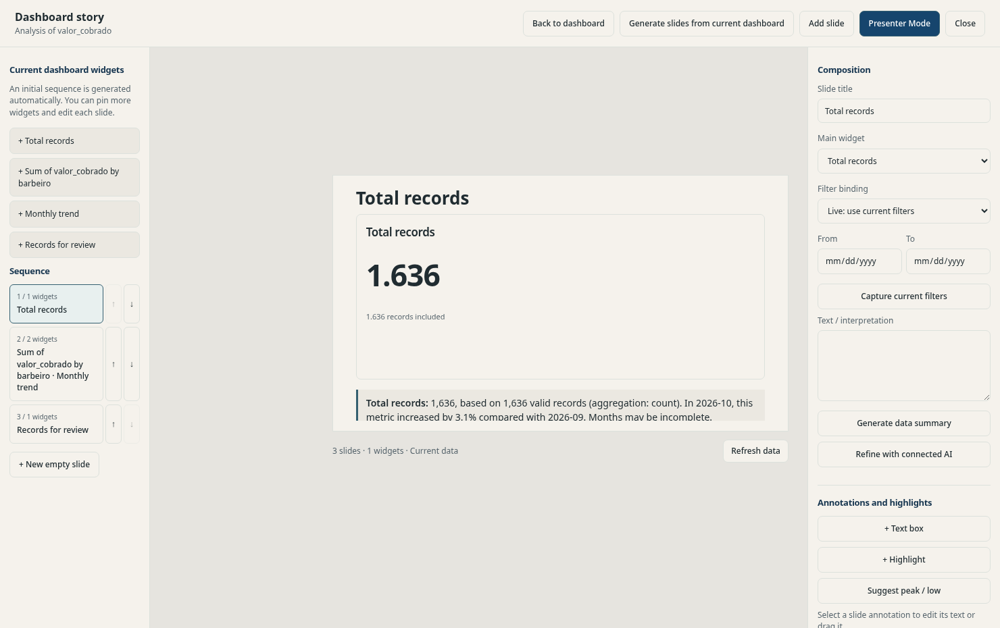
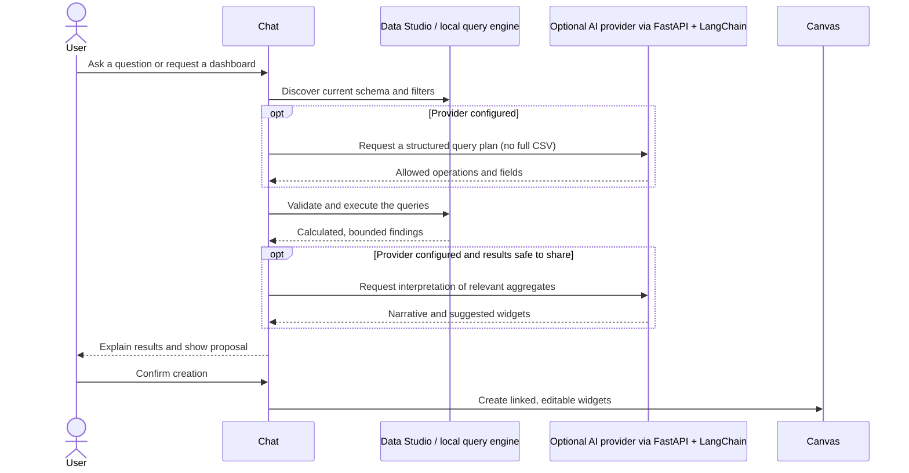

<div align="center">


# InsightLab Studio

**Your business generates data every day. InsightLab helps you understand what it is telling you.**

*An interactive, local-first analytics workspace that turns CSV files into conversations, editable dashboards, and data-linked stories.*

[](README.md)
[](README.pt-BR.md)

   

</div>



<sub>Actual InsightLab interface running with the synthetic barbershop sample included in this repository.</sub>

### Language selection in the application

The interface can be switched between **English** and **Português (Brasil)** using the clearly labeled **Language / Idioma** control in the sidebar or the language selector in the header on smaller screens. The setting is saved locally and also controls the language of new assistant responses.

<details>
<summary>View the bilingual login screen</summary>



</details>

## Why InsightLab exists

**InsightLab began with a simple problem: entrepreneurs record a lot of information, but it is not always easy to understand what those records say about the health of their business.**

Sales, appointments, products, expenses, and daily operations often end up in Excel or CSV spreadsheets. The information is there, but finding patterns, understanding changes, and identifying what deserves attention can require formulas, manually assembled charts, or time the business owner does not have.

The idea was to make that experience **lighter, more organized, more visual, and more conversational**.

Instead of only opening a spreadsheet, a user should be able to ask:

> **“How is my business doing?”**  
> **“Which service generates the most revenue?”**  
> **“What changed this month?”**  
> **“Can you build a dashboard that helps me monitor this?”**

InsightLab brings those steps into one workspace. **It is not trying to replace Excel's spreadsheet capabilities; it adds an approachable layer of exploration, analysis, and decision support on top of the data people already collect.**

## From spreadsheet to understanding



The user stays in control: **the assistant proposes actions; it does not silently overwrite dashboards**. Analyses are calculated against the imported data, and saved widgets remain connected to their source.

### Import your spreadsheet, your way



<sub>Smart Data Import detects column types and suggests roles. The user can approve or correct the mapping without discarding unselected columns.</sub>

## Meet the data assistant

The chat is not a separate demo or a decorative chatbot. It is the main interaction layer connecting **Data Studio, analytical queries, the Canvas editor, and Dashboard Story**.



<sub>The same screen keeps the source data accessible while the assistant explains the results.</sub>

### 1. Ask questions about real CSV columns

<p align="center"></p>

The assistant can examine the columns available in the current dataset and calculate quantities, sums, averages, distributions, and text frequencies. In the barbershop example, asking **“How many appointments are in this dataset?”** returns **1,755 records**, calculated from the supplied sample file.

Simple, deterministic questions can run locally **without spending model tokens**. More open-ended interpretation benefits from a configured language model. The chat uses high-contrast message bubbles for readability in both visual themes.

### 2. Ask the agent to build a dashboard

<p align="center"></p>

For example, with `examples/barbearia.csv` loaded, ask:

> **“How much revenue did the barbershop generate? Compare revenue by barber and create a dashboard with the most useful indicators.”**

The assistant can examine fields such as `valor_cobrado`, `barbeiro`, `servico`, and `data_atendimento`, calculate relevant metrics, and propose KPI cards, breakdown charts, time series, and a detail table. **Review and confirm** the proposal to create an editable dashboard; the existing project is preserved.

### 3. Continue from Canvas into Dashboard Story



<sub>The storyline is generated from the active dashboard; its widgets remain bound to the original data.</sub>

The selected dashboard can become a **data-linked analytical storyline**. Dashboard Story uses the existing widget IDs, supports pinned or dynamic filters, annotations, and presenter mode. Its purpose is to explain the findings, **not** to export a disconnected PowerPoint-like copy.

### What the agent actually does

| Request | What happens |
|---|---|
| “How many appointments were recorded?” | Counts matching records in the active dataset. |
| “Which barber generated the most revenue?” | Groups the selected numeric measure by the relevant column. |
| “How often does the word *prancha* appear?” | Searches text in the imported columns and counts occurrences locally. |
| “Create a dashboard for my business.” | Plans relevant widgets, presents a proposal, and awaits approval before creating in Canvas. |
| “Improve my current dashboard.” | Suggests a revised dashboard without silently replacing the original. |
| “Schedule a review.” | Opens the agenda flow for user confirmation. |

**Important distinction:** the local engine supports structured calculations and basic heuristics. With a provider configured, the AI can plan queries and explain computed findings. It does **not** autonomously know every business rule; ambiguous columns, profit definitions, cancelled orders, and financial transfers may require user confirmation. External email sending is **not implemented**.

### How the AI connection works



The current system combines **local computation with optional language-model planning and interpretation**. It sends column metadata and selected aggregate results rather than blindly uploading the whole CSV. This improves efficiency, but does not eliminate privacy risks in small or identifiable groups. See [Agent workflow](docs/AGENT_WORKFLOW.md) and [Security](SECURITY.md).

## What you can do

| Workspace | Capabilities |
|---|---|
| **Smart Data Import** | Automatic, guided, or hybrid column mapping; preserves original fields. |
| **Data Studio** | Spreadsheet-like editing, search, date/status filters, sorting, pagination, filtered export. |
| **Chat & AI assistant** | Ask questions, calculate metrics, count words, propose dashboards, open agenda actions. |
| **No-code Canvas** | Configure KPI cards, charts, tables and metrics; keep and reopen projects. |
| **Dashboard Story** | Automatically organize current dashboard widgets into linked slides, annotate and present. |
| **AI Settings & logs** | Configure optional providers and inspect limited operational information and token metrics when available. |
| **Local-first experience** | CSV calculations and project storage primarily run in the browser; no paid AI account required for the demo mode. |

## Try three different businesses

The repository includes **fictional datasets** with different field structures. They test whether the system can adapt beyond a fixed sales spreadsheet.

| Business | File | Try asking |
|---|---|---|
| Barbershop | [`examples/barbearia.csv`](examples/barbearia.csv) | “Compare revenue and average service duration by barber.” |
| Pizzeria | [`examples/pizzaria.csv`](examples/pizzaria.csv) | “Which product categories and sales channels deserve attention?” |
| Toy store | [`examples/brinquedos.csv`](examples/brinquedos.csv) | “Which products sell the most, and which need stock monitoring?” |

**Recommended first run — Barbershop:** import the CSV, choose **Hybrid** mapping, verify `data_atendimento` as the date, `valor_cobrado` as the amount, `barbeiro` as a grouping field and `servico` as a category. Ask the assistant for a revenue overview, review its calculations, then request a dashboard. The fixture contains **1,755 appointment rows**, of which **1,636** are completed. The sum of `valor_cobrado` is **R$ 83,379.46** (synthetic data). See [examples](examples/README.md) for more.

## Interface languages — English and Portuguese

The **entire interactive workspace** now includes a language selector with **Português (BR)** and **English**. Use it from the demo login, the top toolbar, or **Preferences → Language**. The choice is saved in this browser and applies to navigation, Data Studio, Smart Data Import, Canvas controls, Dashboard Story, Calendar, AI settings, and assistant interactions.

Local analytical explanations and generated slide narratives follow the selected language. When an AI provider is connected, the frontend sends an optional `locale` field to the backend so the model is instructed to respond in the chosen language. **Your original CSV column names and values, stored dashboard titles, and earlier conversation messages are not automatically translated.** Figures continue to represent the same values and currency, with locale-aware number formatting.

For implementation details, see [Localization architecture](docs/LOCALIZATION.md).

## Quick start

### Windows

**Requirements:** Windows 10/11 and Python 3.11 or 3.12 available as `py` or `python`.

1. Clone/download this repository and open the project root (`insightlab_langchain`).
2. Run **`start.bat`**. It prepares the backend environment and starts services on **`127.0.0.1`**.
3. Open [http://127.0.0.1:5500](http://127.0.0.1:5500) if the browser does not open automatically.
4. Enter using the demo profile **User**; import [`examples/barbearia.csv`](examples/barbearia.csv) into Data Studio.
5. Click the chat icon at the lower-right corner and ask your first question.

### Linux / macOS (manual)

From the project root, with Python 3.11+:

```bash
python -m venv backend/.venv
source backend/.venv/bin/activate
python -m pip install -r backend/requirements.txt
export INSIGHTLAB_ADMIN_TOKEN="$(python -c 'import secrets; print(secrets.token_urlsafe(32))')"
(cd backend && python -m uvicorn app:app --host 127.0.0.1 --port 8000)
```

In **another terminal**:

```bash
python -m http.server 5500 --bind 127.0.0.1 --directory insightlab_mvp
```

On Windows PowerShell, use `backend\.venv\Scripts\Activate.ps1` and `$env:INSIGHTLAB_ADMIN_TOKEN='your-random-token'` instead. Visit [the detailed setup guide](docs/INSTALLATION.md) for troubleshooting.

### Optional: connect an AI model

Open **Settings**, supply the locally generated administrative token (`backend/.insightlab_admin_token` when launched by `start.bat`), and configure a supported provider, model and API key. The application uses FastAPI/LangChain for assisted planning and explanations. Without a provider, the basic local analytical mode still works. **Never commit or share tokens or provider keys.**

## Technology and engineering decisions

- **Frontend:** HTML, CSS and JavaScript; an editable no-code Canvas and a responsive interface.
- **Analytics:** schema-aware local queries, dataset revisions and cached aggregations shared by Canvas and Dashboard Story.
- **AI orchestration:** Python, FastAPI, Pydantic and LangChain; structured query planning and evidence-based responses.
- **Persistence:** browser `localStorage` for this demo; dashboard exports support manual backup.
- **Quality:** Node.js tests, pytest, optional browser smoke tests and a GitHub Actions workflow.

Read the [Architecture](docs/ARCHITECTURE.md), [Agent Workflow](docs/AGENT_WORKFLOW.md), [Data Binding](docs/DATA_BINDING.md), and [Testing](docs/TESTING.md) documentation.

<details>
<summary><strong>Run the automated checks</strong></summary>

```bash
node tests/stage1_integrity.test.cjs
node tests/stage2_query_engine.test.cjs
node tests/stage2_business_fixtures.test.cjs
python -m pytest -q tests/test_backend_security.py
python scripts/audit_release.py
```

</details>

## Project scope and limitations

> **v11.0 Release Candidate — local portfolio MVP, not a production SaaS.**

- The **User** login is a mock. It is **not real authentication, RBAC, or tenant isolation**. Do not expose the administrative API publicly.
- Data and saved dashboards live in the current browser. This is **not** cloud collaboration or automatic backup; export important projects.
- Large CSV files may require a future worker/IndexedDB/server-based analytical engine.
- Model support and answer quality depend on external credentials, model availability, the question and the correctness of field mapping.
- Domain-specific conclusions (profit, cash flow, appointments, inventory) require the correct business definitions. Always review inferred measures.
- Operational logs are limited; there are no production-grade user quotas, enterprise privacy controls, or multi-user permissions.
- Real provider calls and Windows startup are **not** part of the automated CI tests.

## Contributing, security and license

See [Contributing](CONTRIBUTING.md), [Security Policy](SECURITY.md), and [Change history](CHANGELOG.md). Repository code is released under the [MIT License](LICENSE); third-party dependencies retain their own licenses.

---

<div align="center">

**From rows and columns to questions, insights, and decisions.**

[English](README.md) · [Português (Brasil)](README.pt-BR.md)

</div>
