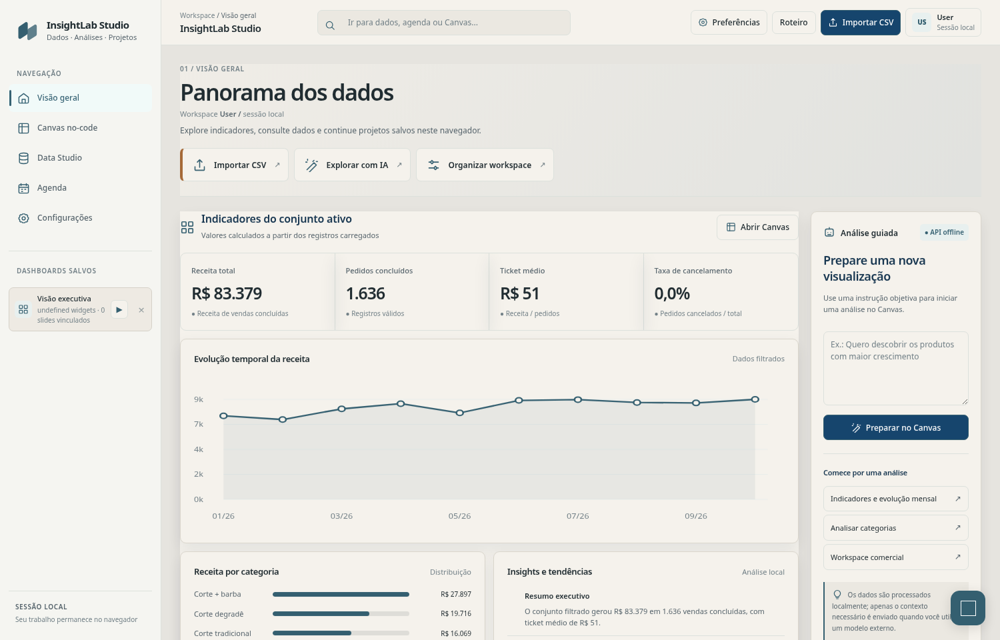
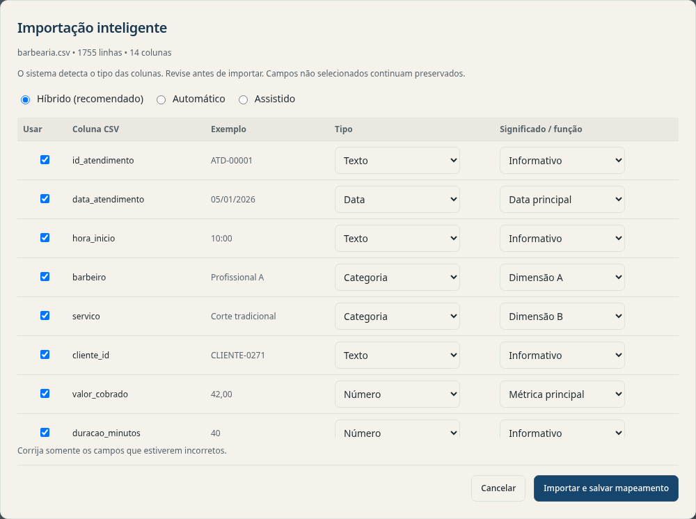
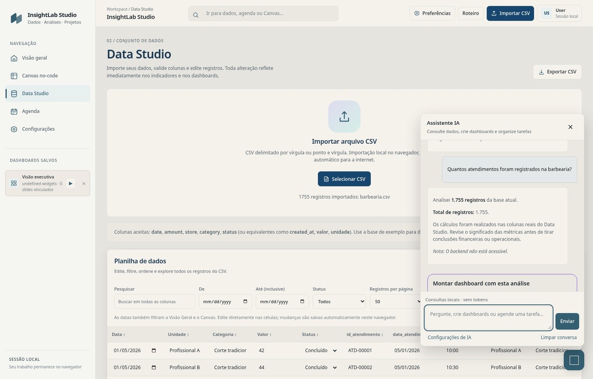
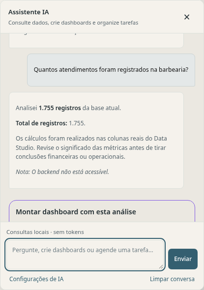
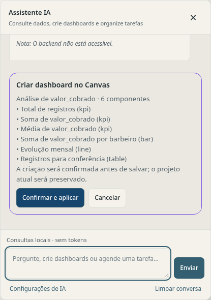
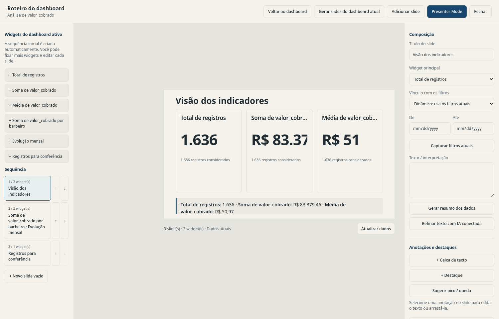
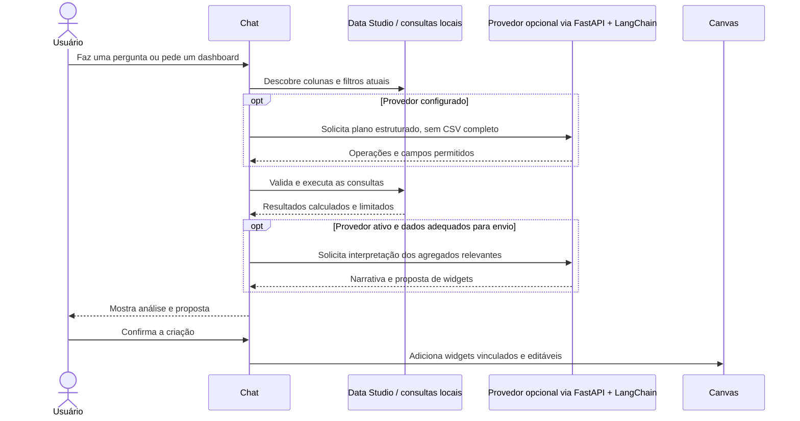

<div align="center">


# InsightLab Studio

**Sua empresa gera dados todos os dias. O InsightLab ajuda você a entender o que eles estão dizendo.**

*Um workspace analítico, visual e interativo que transforma arquivos CSV em conversas, dashboards editáveis e narrativas vinculadas aos dados.*

[](README.md)
[](README.pt-BR.md)

   

</div>



<sub>Captura real da interface do InsightLab utilizando o CSV sintético da barbearia incluído no repositório.</sub>
## Guia de Usuário
📖 [Guia de Usuário](https://insightlab-user-guide.vercel.app/)
## Por que o InsightLab nasceu?

**O InsightLab nasceu de uma necessidade simples: o empreendedor registra muita informação, mas nem sempre consegue enxergar com clareza o que esses registros revelam sobre a situação real do seu negócio.**

Vendas, atendimentos, produtos, despesas e operações diárias acabam em planilhas do Excel ou arquivos CSV. Os dados existem, mas identificar padrões, perceber mudanças e decidir o que merece atenção pode exigir fórmulas, gráficos montados manualmente e um tempo que nem sempre sobra na rotina de quem empreende.

A proposta foi criar uma experiência **mais leve, organizada, visual e conversacional**.

Em vez de apenas abrir uma planilha, o usuário deveria conseguir perguntar:

> **“Como está a situação da minha empresa?”**  
> **“Qual serviço gera mais faturamento?”**  
> **“O que mudou neste mês?”**  
> **“Você consegue montar um dashboard para eu acompanhar isso?”**

O InsightLab reúne essas etapas em um só ambiente. **Não pretende substituir todos os recursos do Excel; oferece uma camada mais acessível para explorar, compreender e apresentar os dados que o usuário já registra.**

## Da planilha à compreensão


O usuário mantém o controle: **o assistente propõe ações, mas não sobrescreve dashboards silenciosamente**. As análises são calculadas a partir da base importada, e os widgets salvos continuam vinculados à fonte dos dados.

### Importe seus dados do seu jeito



<sub>A importação inteligente reconhece os tipos e sugere funções para as colunas. Você pode revisar o mapeamento sem perder as demais informações do CSV.</sub>

## Conheça o assistente de dados

O chat não é apenas uma demonstração isolada ou um chatbot decorativo. Ele conecta o **Data Studio, o motor de consultas, o Canvas e o Dashboard Story** em uma única experiência.



<sub>O empreendedor continua vendo os dados de origem enquanto conversa com o assistente sobre seus resultados.</sub>

### 1. Faça perguntas sobre as colunas reais do CSV

<p align="center"></p>

O assistente consegue identificar as colunas disponíveis na base atual e calcular quantidades, somas, médias, distribuições e frequência de palavras. No exemplo da barbearia, a pergunta **“Quantos atendimentos existem nesta base?”** retorna **1.755 registros**, calculados diretamente do CSV de demonstração.

Perguntas simples e determinísticas podem ser respondidas localmente **sem gastar tokens de IA**. Já interpretações abertas se beneficiam de um modelo configurado. As mensagens do usuário usam contraste reforçado nos temas claro e escuro.

### 2. Peça ao agente para montar um dashboard

<p align="center"></p>

Por exemplo, depois de importar `examples/barbearia.csv`, pergunte:

> **“Quanto a barbearia faturou? Compare o faturamento por barbeiro e crie um dashboard com os indicadores mais úteis.”**

O assistente consegue utilizar campos como `valor_cobrado`, `barbeiro`, `servico` e `data_atendimento`, calcular métricas relevantes e propor indicadores, gráficos por categoria, evolução temporal e tabela de conferência. Após **revisar e confirmar**, o usuário cria um dashboard editável; o projeto anterior é preservado.

### 3. Transforme o Canvas em uma narrativa de dados



<sub>O roteiro é gerado a partir do dashboard atual; cada widget segue conectado à fonte de dados.</sub>

O dashboard selecionado pode se transformar em um **roteiro analítico vinculado à fonte original**. O Dashboard Story reutiliza os IDs dos widgets, aceita filtros dinâmicos ou fixados, anotações e modo apresentador. Seu objetivo é explicar os resultados, **não** exportar uma cópia desconectada ao estilo PowerPoint.

### O que o agente realmente consegue fazer?

| Pedido | Comportamento |
|---|---|
| “Quantos atendimentos foram registrados?” | Conta os registros da base ativa. |
| “Qual barbeiro gerou mais receita?” | Agrupa a métrica numérica selecionada pelo profissional. |
| “Quantas vezes aparece a palavra *prancha*?” | Pesquisa textos nas colunas importadas e conta ocorrências localmente. |
| “Crie um dashboard para meu negócio.” | Propõe widgets e pede confirmação antes de criar no Canvas. |
| “Melhore meu dashboard atual.” | Sugere uma versão revisada, sem substituir silenciosamente a original. |
| “Agende uma revisão.” | Abre o fluxo da agenda para confirmação do usuário. |

**Diferença importante:** o motor local realiza cálculos estruturados e usa regras de identificação básicas. Quando um provedor está conectado, a IA pode planejar consultas e explicar resultados calculados. O sistema **não conhece automaticamente todas as regras de qualquer negócio**: colunas ambíguas, definições de lucro, pedidos cancelados e transferências financeiras podem exigir confirmação. O envio real de e-mails externos **não foi implementado**.

### Como funciona a integração de IA



O projeto combina **processamento local com planejamento e interpretação opcionais por modelos de linguagem**. Em vez de enviar o CSV inteiro indiscriminadamente, utiliza o esquema das colunas e resultados agregados necessários. Isso contribui para eficiência, mas não elimina riscos de privacidade em grupos pequenos ou identificáveis. Saiba mais em [Fluxo do agente](docs/AGENT_WORKFLOW.md) e [Segurança](SECURITY.md).

## Funcionalidades do sistema

| Módulo | Recursos |
|---|---|
| **Smart Data Import** | Mapeamento automático, assistido ou híbrido; preserva as colunas originais. |
| **Data Studio** | Edição de planilha, busca, filtros por data e status, ordenação, paginação e exportação filtrada. |
| **Chat / Assistente de IA** | Perguntas, cálculos, frequência de palavras, propostas de dashboards e ações na agenda. |
| **Canvas no-code** | Indicadores, gráficos, tabelas, métricas editáveis e projetos salvos. |
| **Dashboard Story** | Roteiros gerados a partir do dashboard atual, slides vinculados, anotações e modo apresentador. |
| **Configurações e logs** | Provedores de IA opcionais e informações operacionais limitadas, incluindo tokens quando disponíveis. |
| **Experiência local** | Análise de CSV e salvamento de projetos principalmente no navegador; demo funcional sem API paga. |

## Experimente três negócios diferentes

O repositório inclui **bases fictícias** com estruturas distintas, para testar a adaptação além de planilhas comerciais padronizadas.

| Negócio | Arquivo | Pergunta sugerida |
|---|---|---|
| Barbearia | [`examples/barbearia.csv`](examples/barbearia.csv) | “Compare faturamento e duração média por barbeiro.” |
| Pizzaria | [`examples/pizzaria.csv`](examples/pizzaria.csv) | “Quais categorias de produto e canais de venda merecem atenção?” |
| Loja de brinquedos | [`examples/brinquedos.csv`](examples/brinquedos.csv) | “Quais brinquedos vendem mais e quais precisam de atenção no estoque?” |

**Primeiro teste recomendado — Barbearia:** importe o CSV, selecione o modo **Híbrido** e revise `data_atendimento` como data, `valor_cobrado` como métrica, `barbeiro` como agrupamento e `servico` como categoria. Pergunte ao assistente pelo faturamento, confira o resultado e peça um dashboard. A base contém **1.755 atendimentos**, sendo **1.636 concluídos**. A soma de `valor_cobrado` é **R$ 83.379,46** (dados sintéticos). Consulte a [documentação dos exemplos](examples/README.md).

## Idiomas disponíveis — Português e inglês

A **interface interativa do InsightLab** agora oferece **Português (BR)** e **English**. Você pode selecionar o idioma no login demonstrativo, na barra superior ou em **Preferências → Idioma**. A escolha fica salva neste navegador e se aplica à navegação, Data Studio, Importação Inteligente, Canvas, Dashboard Story, Agenda, Configurações e interações do assistente.

Os resumos analíticos locais e as narrativas automáticas dos slides seguem o idioma escolhido. Quando um provedor de IA está conectado, o frontend envia o campo opcional `locale` ao backend para orientar o modelo a responder nessa língua. **Nomes e valores originais das colunas do CSV, títulos salvos de dashboards e mensagens antigas da conversa não são traduzidos automaticamente.** As métricas permanecem iguais, com formatação numérica adequada ao idioma e mantendo a moeda dos dados.

Veja os detalhes em [Arquitetura de localização](docs/LOCALIZATION.md).

## Instalação rápida

### Windows

**Requisitos:** Windows 10/11 e Python 3.11 ou 3.12 disponível como `py` ou `python`.

1. Clone ou baixe este repositório e abra a pasta principal (`insightlab_langchain`).
2. Execute **`start.bat`**. Ele prepara o backend e inicia os serviços em **`127.0.0.1`**.
3. Acesse [http://127.0.0.1:5500](http://127.0.0.1:5500) se o navegador não abrir automaticamente.
4. Entre com o perfil demonstrativo **User** e importe [`examples/barbearia.csv`](examples/barbearia.csv) no Data Studio.
5. Clique no ícone de conversa no canto inferior direito e faça sua primeira pergunta.

### Linux / macOS (manual)

Na raiz do repositório, com Python 3.11+:

```bash
python -m venv backend/.venv
source backend/.venv/bin/activate
python -m pip install -r backend/requirements.txt
export INSIGHTLAB_ADMIN_TOKEN="$(python -c 'import secrets; print(secrets.token_urlsafe(32))')"
(cd backend && python -m uvicorn app:app --host 127.0.0.1 --port 8000)
```

Em **outro terminal**:

```bash
python -m http.server 5500 --bind 127.0.0.1 --directory insightlab_mvp
```

No Windows PowerShell, utilize `backend\.venv\Scripts\Activate.ps1` e `$env:INSIGHTLAB_ADMIN_TOKEN='seu-token-aleatorio'`. Consulte o [guia detalhado](docs/INSTALLATION.md) para configuração e resolução de problemas.

### Opcional: conectar um modelo de IA

Acesse **Configurações**, informe o token administrativo gerado localmente (`backend/.insightlab_admin_token` quando iniciado por `start.bat`) e configure o provedor, modelo e chave da API. O projeto utiliza FastAPI/LangChain para planejamento e explicações assistidas. Sem provedor, o modo analítico local básico continua funcionando. **Nunca publique ou compartilhe tokens e chaves.**

## Tecnologias e decisões de engenharia

- **Frontend:** HTML, CSS e JavaScript; Canvas no-code editável e interface responsiva.
- **Análise:** consultas locais orientadas por esquema, revisões de dataset e cache de agregações compartilhado pelo Canvas e Dashboard Story.
- **Orquestração de IA:** Python, FastAPI, Pydantic e LangChain; planejamento estruturado e respostas apoiadas em resultados calculados.
- **Persistência:** `localStorage` neste MVP; exportação dos dashboards para backup manual.
- **Qualidade:** testes Node.js, pytest, testes opcionais no navegador e GitHub Actions.

Explore [Arquitetura](docs/ARCHITECTURE.md), [Fluxo do agente](docs/AGENT_WORKFLOW.md), [Data Binding](docs/DATA_BINDING.md) e [Testes](docs/TESTING.md).

<details>
<summary><strong>Executar verificações automatizadas</strong></summary>

```bash
node tests/stage1_integrity.test.cjs
node tests/stage2_query_engine.test.cjs
node tests/stage2_business_fixtures.test.cjs
python -m pytest -q tests/test_backend_security.py
python scripts/audit_release.py
```

</details>

## Escopo e limitações

> **v11.0 Release Candidate — MVP local de portfólio, não um SaaS pronto para produção.**

- O login **User** é demonstrativo. **Não é autenticação real, RBAC ou isolamento entre clientes.** Não exponha a API administrativa publicamente.
- CSVs e dashboards ficam no navegador atual; **não há** colaboração em nuvem ou backup automático. Exporte projetos importantes.
- CSVs muito grandes podem exigir futuramente Web Workers, IndexedDB ou um motor analítico no servidor.
- A qualidade das respostas depende das credenciais, da disponibilidade do modelo, da pergunta e do mapeamento correto dos campos.
- Conclusões específicas (lucro, fluxo de caixa, atendimentos e estoque) exigem definições de negócio adequadas; revise métricas inferidas.
- Logs e controles de uso são limitados; não há cotas corporativas, políticas avançadas de privacidade nem permissões multiusuário.
- Chamadas reais a provedores e execução do `start.bat` no Windows **não fazem parte dos testes automatizados da CI**.

## Contribuição, segurança e licença

Veja [Contribuições](CONTRIBUTING.md), [Política de segurança](SECURITY.md) e [Histórico de alterações](CHANGELOG.md). O código do repositório usa a [Licença MIT](LICENSE); dependências de terceiros mantêm suas licenças.

---

<div align="center">

**De linhas e colunas para perguntas, descobertas e decisões.**

[English](README.md) · [Português (Brasil)](README.pt-BR.md)

</div>
