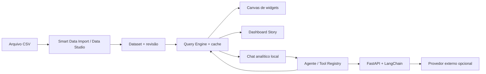

# Arquitetura do InsightLab Studio v11.0 RC

## Visão geral

O projeto usa **HTML/CSS/JavaScript sem framework SPA obrigatório** no frontend, com uma API **FastAPI/Pydantic** para integração de IA. A interface e os datasets são predominantemente executados em memória do navegador. O backend não é um banco de dados analítico centralizado e não armazena os CSVs por padrão.

## Componentes e responsabilidades

| Arquivo | Responsabilidade |
|---|---|
| `insightlab_mvp/index.html` | Layout da aplicação, importação inicial e eventos legados da interface |
| `insightlab_mvp/smart-import.js` | Revisão de colunas e mapeamento na importação |
| `insightlab_mvp/integrity-v104.js` | Identidade, revisão e validação de vínculos/importação |
| `insightlab_mvp/query-engine-v105.js` | Agregações e filtro compartilhados, cache limitado por revisão |
| `insightlab_mvp/builder.js` | Widget Canvas e projetos de dashboards |
| `insightlab_mvp/presentation-studio.js` | Roteiro com referências a widgets, filtros capturados e anotações |
| `insightlab_mvp/assistant-data-engine.js` | Consultas locais de dados para o chat e ferramentas analíticas |
| `insightlab_mvp/intelligence-chat.js` | Conversa com dados, roteamento de solicitação e revisão de ações |
| `insightlab_mvp/recent-projects.js` | Biblioteca de dashboards, atualizada por eventos |
| `backend/app.py` | Endpoints FastAPI, segurança por token administrativo, logs em memória, configuração e inferência |
| `backend/assistant_tools.py` | Plano de consultas e ferramentas analíticas associadas ao agente |

A interface foi acumulando módulos ao longo das versões; existem scripts legados. A Etapa 2 reduziu acoplamento sem reescrever a aplicação. Uma migração futura poderia adotar módulos ES e separar por domínios, mas **não é pré-requisito** para esta release de portfólio.

## Identidade e revisão dos dados

Cada CSV importado recebe `datasetId`; toda edição relevante incrementa `datasetRevision`. Dashboards vinculam-se à fonte por ID. O Dashboard Story preserva referências de widgets, não HTML estático. Um slide em modo **fixado** mantém os filtros capturados, mas recalcula os valores a partir da revisão mais recente da **mesma base**. Um CSV diferente não pode assumir essa identidade automaticamente.

Leia [`DATA_BINDING.md`](DATA_BINDING.md) para exemplos e limites da importação/exportação.

## Fluxo de IA

1. Usuário envia uma pergunta no chat.
2. Ferramentas locais verificam se a resposta é determinística (busca, contagem, agregação).
3. Para perguntas abertas, o agente pode planejar consultas validadas em cima do esquema do dataset; a execução sobre registros acontece localmente.
4. Apenas o contexto e os resultados necessários são enviados ao provedor configurado para interpretação quando solicitado.
5. Uma proposta de dashboard passa por revisão do usuário antes de ser aplicada ao Canvas.
6. Se o dashboard for gerado, o Dashboard Story pode construir a sequência vinculada aos widgets.

**Atenção:** a API de IA não constitui uma sandbox arbitrária de SQL/Python. O código usa operações predefinidas para evitar executar instruções do modelo como código.

## Persistência e limites

- Projetos e estado local: `localStorage`; sem colaboração entre dispositivos.
- Dados analisados: memória do navegador; não adequado a grandes conjuntos sem otimizações adicionais.
- IA: chaves do provedor e modelo ativo em RAM do processo FastAPI.
- Logs: memória do backend, capacidade limitada, sem armazenar prompts brutos por padrão.
- Segurança: token único para endpoints administrativos; **não existe RBAC real**.

## Escopo de produção

Não utilize o frontend mock e a API single-admin como SaaS. Para produção seriam necessários autenticação, autorização por recurso, armazenamento no servidor, rate limiting, gestão de segredos, retenção e exclusão de dados, políticas de privacidade e testes de intrusão.
